# lane

[](https://github.com/vannt-dev/lane/actions/workflows/ci.yml)
[](LICENSE)
[](https://vannt-dev.github.io/lane/)

Run several tasks of one git repository at the same time, each in its own worktree (a
"lane"), usually with one coding agent per lane, without the tasks stepping on each other.

Lanes are **slots**: numbered worktrees `<lane root>/<repo>-<n>` that are reused. A task
holds a slot with `git worktree lock` and gives it back when its work is pushed; the folder,
its dependencies and build caches stay, so the next task starts in seconds instead of
checking out and installing again.

<picture>
  <source media="(prefers-color-scheme: dark)" srcset="https://raw.githubusercontent.com/vannt-dev/lane/main/docs/diagrams/overview-dark.svg">
  
</picture>

## Why

Coding agents work best one task per checkout. `git worktree` gives each task its own folder,
but on its own it leaves the hard parts to you: a fresh worktree needs its dependencies
installed again, two agents fight over one Android emulator or one dev-server port, heavy
builds run four at a time and run out of memory, and two branches that merge cleanly as
text can still break each other once both are in. lane handles those parts:

- **Reused slots.** A task takes a slot, the slot keeps `node_modules` and build caches, and
  dependencies are installed again only when a lockfile changed.
- **Safe holds.** A slot is held with `git worktree lock` and a lease; another session never
  takes it, and `lane done` refuses to give back work that is not on the remote.
- **Shared things.** `lane claim emulator`, `lane with build -- <cmd>` (two at a time) and a
  port range per slot (`lane port 3000`).
- **Merge safety.** `lane verify` merges all open lanes together and runs the checks before
  the first one merges; `lane sync` rebases the rest and checks them again after.
- **Agent notes.** Each lane gets a `CLAUDE.local.md` (and `lane brief` for sub-agents) with
  these rules, so Claude Code in the lane follows them.

lane works with any agent or none. With [junto](https://github.com/vannt-dev/junto) each lane
keeps its own task, and `/junto:status all` shows every lane's task in one table.

## Install

Node 22.18+, git, and `gh` (logged in) for pull request and CI state. lane is written in
TypeScript and runs as is (Node strips the types, no build step), so it installs from a clone:
Node does not run `.ts` files inside `node_modules`, and lane is not published to npm.

```sh
git clone https://github.com/vannt-dev/lane && cd lane
npm install && npm link    # puts `lane` on PATH
```

Then tell lane where your clones are and where the slots go. Both are required; lane stops
with a message naming the missing one.

```sh
# Windows (new terminals pick it up)
setx LANE_REPOS D:/code
setx LANE_ROOT D:/wt

# macOS / Linux: in ~/.bashrc, ~/.zshrc or similar
export LANE_REPOS="$HOME/code"
export LANE_ROOT="$HOME/wt"
```

lane was built and is used daily on Windows; CI runs it on Windows, Ubuntu and macOS.
`lane new --open` starts Claude Code in a new Windows Terminal tab on Windows, in a new tmux
window inside tmux; elsewhere (or when that fails) it prints the command to run.

## Quick start

```sh
lane new myrepo feat/login        # slot myrepo-1 on a new branch feat/login, ready to work in
cd "$LANE_ROOT/myrepo-1" && claude
# ... commit, push, open the pull request ...
lane done myrepo-1               # once pushed: the slot goes back to the pool, caches kept
lane list                         # every lane: held or free, branch, changes, PR and CI
```

| Variable | Meaning |
| --- | --- |
| `LANE_REPOS` | Required. `<repos folder>`: the folder holding the main clones; `<repo>` names one of them |
| `LANE_ROOT` | Required. `<lane root>`: the folder for the slots (and `.locks`) |
| `LANE_MAX_SLOTS` | Slots per repository (default 4) |
| `LANE_PORT_STRIDE` | Ports per slot (default 10): slot n owns the usual port + n x stride onwards |
| `LANE_LINK_DEPS` | `1`: every `lane new` links npm dependencies from a lane on the same lockfile (see Dependencies from another lane) |
| `LANE_POOLS` | Max slots of named pools, e.g. `review=2,ci=1` (see Pools) |

## Commands

| Command | What it does |
| --- | --- |
| `lane new <repo> <task>` | Takes a slot for the task: the slot it had before, else a free one, else a new one (up to `LANE_MAX_SLOTS`). Locks it (`<task> @ <time> #<lease>`; the lease names this hold), puts it on a new branch (the task name, or `--branch`) from `origin/develop` if the repository has one, else the default branch (`--base` to choose). Loads submodules, copies untracked `.env`, `.env.local`, `android/key.properties`, `.claude/settings.local.json` (more in an untracked `.lanecopy`), installs dependencies only when the lockfiles changed since the slot last installed (npm, pnpm, yarn, bun, Flutter, uv; `--no-install` to skip), writes `CLAUDE.local.md`, then runs the repository's `postCreate` commands (see Repository hooks). `--open` starts Claude Code in a new Windows Terminal tab, or a tmux window inside tmux; elsewhere it prints the command. `--sparse <folder>` (repeatable) checks out only those folders, see Big repositories. |
| `lane new <repo> --pr <n>` | The same, on an existing pull request's branch (tracking it), or on a local `pr-<n>` branch for a PR from a fork. |
| `lane done [<lane>] [--lease ID] [--force]` | Gives the slot back once its work is safe: nothing uncommitted, and its commits on the remote or merged (see Merged). Detaches, deletes the local branch when safe, unlocks. With `--lease`, only while the slot is still held under that lease: a late give-back from a task that already ended never frees the task that came after. `--force` keeps unpushed commits on the local branch. |
| `lane free <lane> [--yes] [--force]` | Frees a hold that looks abandoned (see Left-behind holds). Never when work in it would be lost. `--force` frees one that does not look abandoned. |
| `lane list [--local]` | Every lane: held (task, for how long, and whether it looks abandoned) or free, branch, local changes, PR and CI (`--local`: no GitHub calls). |
| `lane clean [--yes] [--force]` | Gives back the lanes whose work merged (see Merged), removes lanes whose folder is gone and leftover folders, then fast-forwards the main clones. A merged lane still held stays, since follow-up rounds (review fixes, bugs) reuse it, unless its hold looks abandoned or `--force`; one with a claim or a process in it always stays. |
| `lane rm <lane> [--force]` | Deletes a slot for good. Refuses a held slot or unpushed work without `--force`. |
| `lane port <usual port> [k]` | Port k (0 to stride - 1) of this slot's range: the usual port + slot x `LANE_PORT_STRIDE` + k. |
| `lane verify <repo> [--cmd C]... [--keep]` | Merges every open lane of the repository on top of the base, in a slot of the pool, and runs the checks: finds lanes that merge cleanly as text but break each other, before the first one merges. Kept and held when it fails, to look at. |
| `lane sync <repo> [--push] [--cmd C]...` | After a lane merged: rebases the other lanes onto the new base (a conflicting rebase is aborted and the lane left as it was), reinstalls when a lockfile changed, runs the checks. `--push` force-pushes (with lease) those that pass. Skips lanes with local changes, a claim or a process in them, and lanes with no history in common with the base (rewritten history: move that work by hand). |
| `lane brief [<lane>]` | The rules for an agent working in a lane, to paste at the top of its task: an agent started by another session does not read `CLAUDE.local.md`. |
| `lane claim <res>` / `lane release <res>` | Takes and gives back something only one lane may use (the Android emulator). `claim` waits; `--no-wait` fails instead. A claim ends with the lane hold it was made under. |
| `lane with <res> [--slots N] -- <cmd>` | Runs a command holding one of N slots; `build` has 2 (RAM). |
| `lane locks` | Who holds what. |

**Checks** (`verify`, `sync`, `brief`): `--cmd` (repeatable), else an untracked `.lanecheck`
in the main clone (one command per line), else what the checkout has: the `typecheck`,
`lint` and `test` scripts of `package.json`, `flutter analyze` and `flutter test`,
`cargo test`, `go test ./...`. Each check holds a `build` slot.

**A round** with two tasks in one repository:

```sh
lane new myrepo feat/a && lane new myrepo feat/b   # slots myrepo-1 and myrepo-2
lane verify myrepo          # before merging: do the two still pass together?
# merge feat/a's pull request, then:
lane sync myrepo --push     # feat/b onto the new base, checked again, pushed
lane clean --yes --force    # merged slots given back (not one still in use), the main clone pulled
```

## The pool's rules

- **Held** = locked. `git worktree list --porcelain` is the shared state: no registry, and
  `git worktree prune` leaves a locked worktree alone.
- **Free** = not locked, nothing uncommitted, and given back with `lane done` or left
  unchanged for two hours (a session may work in an unlocked slot; its index shows it).
- **Claim** = a lock that reads back as this hold's: lane locks the slot, reads
  `git worktree list --porcelain` again, and goes on only when the lock carries its lease.
  When another session locked or made the slot first, lane leaves that slot alone and picks
  again; a failed switch gives the lock back only while it is still its own.
- A slot held for something else is never taken. A full pool lists the slots with their
  tasks and ages; give one back or raise `LANE_MAX_SLOTS`.
- Speed flags go on each command (`git -c checkout.workers=0 -c core.untrackedCache=true`);
  the repository's own config is not changed.
- Each slot remembers (in `lane.json`, inside its own git folder) the task it held last, the
  lease, the commit the task started from and a stamp of the lockfiles it installed from.

## Merged

A lane's work counts as merged when its PR was merged from the lane's last commit (GitHub),
or, without asking GitHub, when the base branch has it: the lane's commits are in the base, or
merging the lane into the base changes nothing (a squash merge), or the lane's whole change
has the patch id of one commit on the base (a squash merge whose lines were changed again
later). A lane still on the commit it started from has no work and is never merged.

## Left-behind holds

An agent killed or closed without `lane done` leaves its slot locked. A hold looks abandoned
when it is 4 hours old, the slot's index has not changed for 4 hours, and no process uses the
slot: started from it (Linux, where the working folder of a process can be read) or naming it
on its command line (a dev server, a test run). Windows does not tell another process's
working folder, so there a shell sitting in the slot is not seen. `lane list` marks such
holds and `lane free` releases them. Claims on shared things end on their own when the lane
hold they were made under ends (the slot given back or taken for another task).

## How the lanes share

- All lanes of a repository share one `.git`: a commit or fetch in one is seen in the others.
  A branch can be checked out in one lane at a time, so `lane done` detaches the slot.
- Each slot has its own files, dependencies and build output; package caches (pnpm store,
  npm cache, Flutter pub cache) are shared by the tools themselves.
- Locks on shared things live in `<lane root>/.locks`. A `claim` holds until released, its
  lane hold ends, its lane is removed, or three hours pass; a `with` slot is freed when its command ends.
- `CLAUDE.local.md` (ignored through `.git/info/exclude`) tells Claude Code in the lane to
  claim the emulator, run heavy builds through `lane with build`, use `lane port`, keep one
  PR per lane, leave versions and the CHANGELOG alone, and give the slot back when done.
- A repository with a `pre-push` hook (lefthook and husky run the tests there) gets, in each
  lane, its own hooks folder (`core.hooksPath` in the worktree's config): `pre-push` waits for
  a build slot, the other hooks run as before.
- `verify` and `sync` merge and rebase with the repository's hooks off.

## Big repositories: sparse slots

A task that needs a few folders of a big repository does not have to check out all of it:

```sh
lane new bigrepo feat/web --sparse app/web --sparse docs
```

- The slot gets those folders and the files at the root (git's cone mode). A new slot starts
  empty and gets only those files, so a big repository is never written out whole first.
- The setting lives in the slot's own worktree config: the main clone and the other lanes keep
  every file.
- An untracked `.lanesparse` in the main clone (one folder per line, `#` for comments) gives
  every task of that repository its folders; `--sparse` replaces them for one task and
  `--no-sparse` takes everything.
- A reused slot gets what the new task asks for: other folders, or every file again.
  `lane verify` always works on a whole checkout.
- Submodules load only when they sit inside the folders. Untracked files (`.lanecopy` and the
  usual ones) are not copied into a folder of the repository the lane leaves out.
- A monorepo's install can fail when a workspace is outside the folders. A sparse lane then
  says so and is ready without dependencies: add the folder (`git sparse-checkout add`) and
  rerun the install, or take the lane with `--no-sparse`. With `--link-deps` it gets them from a
  whole lane instead (see Dependencies from another lane).
- Checks run in a sparse lane (hooks, `lane sync`, the brief's checks) see only its folders;
  `lane verify` is the check on the whole repository.
- Narrowing a reused slot leaves ignored files (an old `node_modules`) where they were.
- `lane list` shows a slot's folders. `CLAUDE.local.md` and `lane brief` name them and tell the
  agent to add one with `git sparse-checkout add <folder>`, not to turn sparse off.
- A folder missing from the commit (a typo) is named when the lane is made.

## Pools: reviews apart from other work

```sh
lane new myrepo --pr 42 --pool review
```

- A slot belongs to the pool it was made in, for good. A task reuses free slots of its own
  pool only, so a review never takes the slot (and caches) of a feature and the other way round.
- Each pool has its own max: `LANE_POOLS="review=2"`; any other pool, and the default one, has
  `LANE_MAX_SLOTS`. A full pool lists its own slots.
- Slot numbers are shared by all pools, so ports never clash. `lane list` shows the pool after
  the slot's name. Slots made before pools existed are in the default pool.
- Holds still decide what is safe: a slot held in any pool is never taken or cleaned.

## Dependencies from another lane

`lane new <repo> <task> --link-deps` (or `LANE_LINK_DEPS=1` for every lane) skips `npm ci` when
another lane of the repository was installed from the same lockfile: the new lane's
`node_modules` folders (the root one and those of workspaces) are made of hard links to that
lane's files.

- Each lane owns its folders. `rm -rf node_modules/` or `npm ci` in one lane changes that lane
  only; the files on disk are shared until one side replaces them.
- Never a junction or symlink to one shared `node_modules`: deleting through one (Git Bash
  `rm -rf node_modules/` with the trailing slash) empties it for every lane.
- The source lane must have installed from this lockfile and still be on it (no `npm install`
  since). Workspace links point into the new lane. `.cache`, `.vite` and `.vitest` are not linked.
- npm only. pnpm already links from its own store. A repository with a `patches/` folder is not
  linked: patch-package rewrites files in place, and a hard link would carry that to the other
  lanes.
- A sparse lane gets the folders of the workspaces it has, so it has dependencies even when
  `npm ci` would fail on the workspaces it left out.
- Anything that fails (another drive, no link rights) falls back to `npm ci`.

## Repository hooks: .lane.json

A `.lane.json` at the root of the main clone names commands of the repository's own: copy a
file lane does not know about, run codegen, start or stop a container.

```json
{
  "postCreate": ["node scripts/copy-env.js", "npm run codegen"],
  "preDone": "docker compose down"
}
```

- `postCreate` runs at the end of `lane new`, in the lane, after the local files, the install and
  `CLAUDE.local.md`. It runs on every `lane new`, in a new or a reused slot: keep the commands
  safe to run twice. `--no-install` does not skip it.
- `preDone` runs in the lane before `lane done`, `lane free` or `lane clean` gives it back
  (after `lane done` checked the work is pushed).
- Each key takes one command line or a list. They run through the shell (cmd.exe on Windows,
  sh elsewhere), one after the other, output shown, and see `LANE_DIR`, `LANE_NAME`,
  `LANE_SLOT` and `LANE_MAIN` (the main clone). Commands that run on every OS: `node`, `npm run`.
- The first command that fails stops the step and names it. A failed `postCreate` leaves the
  lane held (fix it and rerun the command there); a failed `preDone` keeps the lane held and
  nothing is given back. `lane clean` keeps that lane and goes on with the others.
- lane reads the file from the main clone's folder, committed or not, never from the branch a
  lane checks out: `lane new --pr <n>` does not run commands from someone else's pull request.
  A broken file (bad JSON, an unknown key) stops `lane new` before it takes a slot.

## Known

- Removing a lane falls back to a `\\?\` path delete when git hits Windows' path limit, and
  stops the adb server when it holds the folder open.

## Development

```sh
npm run typecheck   # tsc --noEmit: strict, no unused code
npm test            # node --test, runs the .ts tests directly
```

CI runs both on Ubuntu, Windows and macOS with Node 22.18 and 24. Every file stays under 150
lines. `npm run diagrams` renders the overview diagram from `docs/diagrams/overview.mmd`.

| File | What is in it |
| --- | --- |
| `bin/lane.ts` | Command line |
| `src/index.ts` | What the command line calls |
| `src/commands.ts` | new, done, free, port, brief |
| `src/housekeeping.ts` | list, clean, rm |
| `src/find.ts` | The lane a command is about |
| `src/integrate.ts` | verify and sync (class `Integration`) |
| `src/resources.ts` | claim, release, with, locks |
| `src/checkout.ts` | `Checkout` (a git folder) and `MainClone extends Checkout` |
| `src/lane.ts` | `Lane extends Checkout`: state, merged, giving back, removal |
| `src/meta.ts` | A slot's `lane.json` |
| `src/merged.ts` | Merged work found offline |
| `src/stale.ts` | Left-behind holds, processes using a folder |
| `src/pool.ts` | `SlotPool` and the pure `pickSlot` rule |
| `src/target.ts` | `Target` and its kinds: a new branch, a PR's branch, a fork's, detached |
| `src/setup.ts` | `LaneSetup`: submodules, local files, install, notes, hooks |
| `src/hooks.ts` | The repository's `.lane.json` commands (`postCreate`, `preDone`) |
| `src/checks.ts` | Which checks, and running them under the build cap |
| `src/locks.ts`, `src/lock-state.ts` | Locks on shared things |
| `src/github.ts` | A lane's pull request through `gh` |
| `src/detect.ts`, `src/worktrees.ts`, `src/text.ts` | Pure helpers |
| `src/fsutil.ts`, `src/proc.ts`, `src/config.ts` | Paths and removal, running programs, settings |
